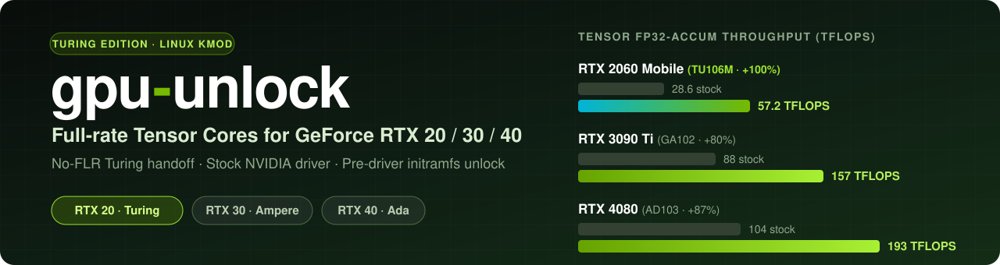

<div align="center">



# gpu-unlock (Turing Fork)

Full-rate Tensor Core unlock for NVIDIA GeForce RTX 20 (Turing), RTX 30 (Ampere) and RTX 40 (Ada) on Linux with the stock NVIDIA driver.

[](https://github.com/Kaspral1/gpu-unlock/releases)
[](#proof-of-work)
[](#supported-gpus)
[](#quick-start)
[](licenses/GPL-2.0.txt)
[](https://github.com/Kaspral1/gpu-unlock/stargazers)
[](https://buymeacoffee.com/kaspral)

[Proof of Work](#proof-of-work) · [Turing Changes](#turing-changes) · [Supported GPUs](#supported-gpus) · [Quick Start](#quick-start) · [How It Works](#how-it-works) · [FAQ](#faq) · [Support](#support)

**Turing Technical Docs:**
[English](docs/How%20Turing%20was%20unlocked.md) · [Polski](docs/Jak_odblokowano_Turing_RTX2060_PL.md) · [中文](docs/turing_unlock_ZH.md) · [Deutsch](docs/turing_unlock_DE.md) · [Español](docs/turing_unlock_ES.md) · [日本語](docs/turing_unlock_JA.md) · [Français](docs/turing_unlock_FR.md)

</div>

---

## Overview

Consumer GeForce cards ship with FP32-accumulation Tensor Core throughput capped to half speed compared to equivalent Quadro, Tesla and RTX A-series silicon. This slows down PyTorch AMP training, LLM prefill, LoRA fine-tuning, FlashAttention and Stable Diffusion / ComfyUI workloads.

`gpu_unlock` is a Linux kernel module loaded early in `initramfs`, before `nvidia.ko` binds the GPU. It lifts the hardware speed cap and hands the device off to the stock, unmodified NVIDIA driver. No patched driver, no VBIOS flash and nothing to redo after driver updates.

> [!NOTE]
> Maintained fork of [`Zagitta/gpu-unlock`](https://github.com/Zagitta/gpu-unlock) adding working NVIDIA Turing (`TU102` / `TU104` / `TU106` / `TU106M`) support while keeping upstream Ampere and Ada support intact.

> [!WARNING]
> **Use at your own risk:** Turing support is experimental and modifies low-level GPU registers at boot. Provided "as is", without warranty of any kind, under GPL-2.0.

---

## Proof of Work

Tested on **Acer Nitro AN515-54** with **NVIDIA GeForce RTX 2060 Mobile (`10de:1f15`, `TU106M`, 30 SMs)**, Linux kernel `7.0.0-42-generic` and stock NVIDIA driver `615.71.09`.

### Kernel Boot Log (`sudo dmesg | grep gpu_unlock`)

```text
[    0.980499] pci 0000:01:00.0: gpu_unlock: stage=claim device=0x1f15 family=TU102/TU104/TU106 cmd=0x102 original=0x102 bar_len=0x1000000 region=1 enabled=0 master=0
[    0.980510] pci 0000:01:00.0: gpu_unlock: stage=layout fb=0x180000000 vga=0x17ff00000 frts=0x100000 wpr=0x177800000..0x17ff00000 boot=0x17fdff000 gsp=0x17e200000 heap=0x177900000
[    0.991917] pci 0000:01:00.0: gpu_unlock: stage=dma booter=59136 payload=0xfa00 pages=7179 meta=0xfffcf000 sig=0xfffd0000 stock=0xfffce000 boot=0xfffcd000
[    0.991930] pci 0000:01:00.0: gpu_unlock: stage=gfw plm=0xffffff8f ss0=0x4010 ss1=0x4 wpr2_hi=0x0
[    1.353047] pci 0000:01:00.0: gpu_unlock: stage=fwsec version=2 fuse=0x0 ver=0 scratch=0x0 wpr2_raw=0x17fe000:0x17fee00 frts=0x17fe000:0x17fee00
[    1.353071] pci 0000:01:00.0: gpu_unlock: stage=publish meta=0xfffcf000 sig=0xfffd0000 size=0xfa00 radix=0xfffcc000
[    1.390038] pci 0000:01:00.0: gpu_unlock: pass=1/2 attempt=1 target=0x409650 value=0xffffffff before=0xffffff8f after=0xffffffff wpr2=0x1778000:0x0 reset_plm=0xff mbox=0x0:0x0 ret=0
[    1.390062] pci 0000:01:00.0: gpu_unlock: pass=2/2 attempt=1 target=0x1fa828 value=0x0 before=0xffffff8f after=0x0 wpr2=0x1778000:0x0 reset_plm=0xff mbox=0x0:0x0 ret=0
[    1.390080] pci 0000:01:00.0: gpu_unlock: stage=host ss0=0x88888888 ss1=0x8 plm_feat=0xffffffff plm_wpr_cfg=0xbadf5040
[    1.390103] pci 0000:01:00.0: gpu_unlock: stage=quiesce-turing wpr2=0x1778000:0x0 ss0=0x88888888 ss1=0x8 readout=0x0 plm=0xffffffef cmd=0x102 devsta=0x19 chip=0x166000a1
[    1.406221] pci 0000:01:00.0: gpu_unlock: stage=handoff ret=0 state=4 retained=0 pages=0/7179 cleanup=0
[    1.406233] pci 0000:01:00.0: gpu_unlock: unlocked
```

### CUDA PTX Tensor Core Benchmark (`python3 scripts/bench_tensor.py`)

Runs `mma.sync.aligned.m16n8k8` PTX kernels comparing unthrottled `FP16 -> FP16` against `FP16 -> FP32` accumulation:

```text
# Before unlock (stock GeForce RTX 2060 Mobile, peak boost):
GPU: NVIDIA GeForce RTX 2060 (30 SMs)
Tensor MMA FP16 -> FP16 accumulate (100% ref): 58.82 TFLOPS
Tensor MMA FP16 -> FP32 accumulate:            28.60 TFLOPS
FP32-accum / FP16-accum ratio:                 48.6% [CAPPED (stock GeForce)]

# After unlock (gpu_unlock active, peak boost):
GPU: NVIDIA GeForce RTX 2060 (30 SMs)
Tensor MMA FP16 -> FP16 accumulate (100% ref): 58.82 TFLOPS
Tensor MMA FP16 -> FP32 accumulate:            57.17 TFLOPS
FP32-accum / FP16-accum ratio:                 97.2% [UNLOCKED]
```

Under thermal or power-limited clocks, absolute TFLOPS scales with boost clock while the `FP32-accum / FP16-accum` ratio stays at 97-100% instead of ~50%.

---

## Turing Changes

1. **No-FLR handoff (`unlock_610.c`, `recipes.c`):** On Turing, `pcie_flr()` runs VBIOS `devinit`, which immediately resets `SS0`/`SS1`. This fork uses a dual-write V67 ROP chain that opens `TU_FEAT_PLM` (`0x409650 = 0xffffffff`) and clears `WPR2_ADDR_HI` (`0x1fa828 = 0x0`) from Heavy-Secure mode, releases ACR mutex 3, zeroes `SEC2_MAILBOX0`, relocks PLM and hands off to `nvidia.ko` without FLR.
2. **GSP Falcon and DMA fixes (`falcon.c`, `unlock_610.c`):** Handles pre-start `GSP_CPUCTL=0x10` (`HALTED`), polls `WPR2_ADDR_HI` before post-FRTS halt, uses the Turing GSP heap formula and sets coherent DMA masks (`32-bit` for `FWSEC-FRTS`, `47-bit` for `SEC2 Booter`).
3. **RTX 2060 Mobile PCI ID (`0x1f15`):** Added `TU106(0x1f15)` alongside `TU102`/`TU104`/`TU106` desktop/mobile IDs, plus error-path FLR recovery in `unlock_transaction_unwind()`.
4. **Verification tools and docs:** Added portable [`scripts/bench_tensor.py`](scripts/bench_tensor.py), [`scripts/check_unlock.sh`](scripts/check_unlock.sh) and Turing technical documentation in 7 languages.

---

## Supported GPUs

Exact PCI IDs are defined in [`kernel/gpu_unlock/recipes.c`](kernel/gpu_unlock/recipes.c). Linux only (for Windows see [FAQ](#faq)).

| Generation | Accelerated Precision (FP32 accum) | Cards in `recipes.c` | Status |
| :--- | :--- | :--- | :--- |
| **Turing (RTX 20)** | **FP16 -> FP32** | RTX 2060 (Desktop & Mobile `10de:1f15`), 2060 SUPER, 2070, 2070 SUPER, 2080, 2080 SUPER, 2080 Ti, Titan RTX | **Verified on `TU106M` (`0x1f15`)**. Reports welcome for RTX 2070 / 2080 / 2080 Ti. |
| **Ampere (RTX 30)** | **FP16 / BF16 / TF32 -> FP32** | RTX 3050, 3060, 3060 Ti, 3070, 3070 Ti, 3080, 3080 Ti, 3090, 3090 Ti, RTX 3070/3080 Laptop | Stable (upstream) |
| **Ada Lovelace (RTX 40)** | **FP16 / BF16 / TF32 -> FP32** | RTX 4060, 4060 Ti, 4070, 4070 SUPER, 4070 Ti, 4070 Ti SUPER, 4080, 4080 SUPER, 4090, 4090 D, RTX 4050/4060 Laptop | Experimental (upstream) |
| **Blackwell (RTX 50)** | None | None | Not supported |

> [!TIP]
> **Laptop / Optimus users:** If the dGPU enters `D3cold` while idle, hardware resets `SS0`/`SS1` until the next reboot. Disable runtime PM to keep the unlock active:
> ```sh
> echo "options nvidia NVreg_DynamicPowerManagement=0x00" | sudo tee /etc/modprobe.d/99-nvidia-no-d3cold.conf
> ```
> Then rebuild initramfs (`sudo update-initramfs -u`, `sudo mkinitcpio -P` or `sudo dracut --regenerate-all --force`).

---

## Benchmarks

### Peak Tensor Core Throughput (FP32 Accumulation, Stock Power Limits)

| GPU | Arch | Stock | Unlocked | Gain |
| :--- | :--- | :---: | :---: | :--- |
| **RTX 2060 Mobile (`10de:1f15`)** | Turing (`TU106M`) | 28.6 TFLOPS | **57.2 TFLOPS** | **+100%** (97.2% of FP16-accum ref) |
| RTX 3060 12 GB | Ampere (`GA106`) | 27 TFLOPS | 51 TFLOPS | +87% |
| RTX 3060 Ti | Ampere (`GA104`) | 37 TFLOPS | 68 TFLOPS | +82% |
| RTX 3070 | Ampere (`GA104`) | 40 TFLOPS | 72 TFLOPS | +81% |
| RTX 3080 10 GB | Ampere (`GA102`) | 65 TFLOPS | 113 TFLOPS | +73% |
| RTX 3090 | Ampere (`GA102`) | 75 TFLOPS | 125 TFLOPS | +65% |
| RTX 3090 Ti (450 W) | Ampere (`GA102`) | 88 TFLOPS | 157 TFLOPS | +80% |
| RTX 4070 Ti | Ada (`AD104`) | 81 TFLOPS | 150 TFLOPS | +84% |
| RTX 4080 | Ada (`AD103`) | 104 TFLOPS | 193 TFLOPS | +87% |
| RTX 4090 | Ada (`AD102`) | 165 TFLOPS | 329 TFLOPS | +100% (peak MMA; power-limited on large GEMMs) |

### Real Workloads

| Workload | Typical Speedup |
| :--- | :--- |
| LLM prefill / prompt processing (FP16/BF16, AWQ/GPTQ in vLLM / PyTorch / Transformers) | **+25-55%** (25-30% lower TTFT) |
| LoRA and full fine-tuning (PyTorch AMP FP16 / BF16) | **+25-50%** |
| Image generation (SD 1.5, SDXL, DiT / Flux in ComfyUI) | **+30-55%** |
| FlashAttention / SDPA kernels | **+50-60%** |
| Video generation (Wan 2.2) | **+15-20%** |
| `llama.cpp` / Ollama (quantized GGUF) | 0-15% (mostly long-context prefill) |
| LLM token decode (memory-bound), INT8/FP8/INT4, gaming and FP32 CUDA | No change |

Outputs are bit-identical before and after.

---

## Quick Start

### 1. Build and Install

```sh
git clone https://github.com/Kaspral1/gpu-unlock.git
cd gpu-unlock
make install
```

`make install` detects Debian/Ubuntu/Mint (`make install-deb`), Arch/CachyOS (`make install-arch`) and Fedora/RHEL (`make install-rpm`), builds the DKMS module and pinned firmware assets, installs them and rebuilds initramfs.

### 2. Enable via Kernel Command Line

The module is opt-in and does nothing until you add `gpu_unlock.targets=all` (or specific PCI addresses such as `gpu_unlock.targets=0000:01:00.0`) to your kernel parameters:

- **GRUB (Debian / Ubuntu / Linux Mint):** add `gpu_unlock.targets=all` to `GRUB_CMDLINE_LINUX_DEFAULT` in `/etc/default/grub`, then run `sudo update-grub`.
- **GRUB (Arch / CachyOS):** same edit, then run `sudo grub-mkconfig -o /boot/grub/grub.cfg`.
- **Fedora / RHEL:** `sudo grubby --update-kernel=ALL --args="gpu_unlock.targets=all"`.
- **systemd-boot:** append to the `options` line in your boot entry (`bootctl status` shows its path).
- **UKI:** add to `/etc/kernel/cmdline` and regenerate images (for example `sudo mkinitcpio -P`).

### 3. Reboot and Verify

```sh
./scripts/check_unlock.sh
# or run separately:
sudo dmesg | grep gpu_unlock
python3 scripts/bench_tensor.py
```

---

## How It Works

`gpu_unlock` combines the `cmpunlocker` V67 SEC2 Booter stack-overflow technique with pre-driver `initramfs` timing. Because Turing and Ampere/Ada differ in register layout and reset behavior, the module uses separate handoff paths:

| Stage | Turing (`TU102` / `TU104` / `TU106`) | Ampere (`GA10x`) & Ada (`AD10x`) |
| :--- | :--- | :--- |
| **Speed selector registers** | `PGRAPH` broadcast: `PLM` `0x409650`, `SS0` `0x40960c`, `SS1` `0x409634` | `0x8238xx` aperture |
| **DMA masks** | `32-bit` for `FWSEC-FRTS`, `47-bit` for `SEC2 Booter` | `32-bit` |
| **V67 ROP writes (L3 HS)** | Dual write: `0x409650 = 0xffffffff` and `0x1fa828 = 0x0` (clears `WPR2` directly) | Opens `FEAT_PLM` |
| **Host writes** | `SS0 = 0x88888888`, `SS1 = 0x8`, then relocks `TU_FEAT_PLM` | `SS0 = 0x88888888`, `SS1 = 0x8` |
| **Post-unlock handoff** | **No-FLR handoff** (`quiesce-turing`), skips `pcie_flr()` so VBIOS `devinit` does not wipe `SS0`/`SS1` | **`pcie_flr()`** to tear down `WPR2` (`SS0`/`SS1` survive FLR on Ampere/Ada) |

Technical documentation:
- Turing: [English](docs/How%20Turing%20was%20unlocked.md) · [Polski](docs/Jak_odblokowano_Turing_RTX2060_PL.md) · [中文](docs/turing_unlock_ZH.md) · [Deutsch](docs/turing_unlock_DE.md) · [Español](docs/turing_unlock_ES.md) · [日本語](docs/turing_unlock_JA.md) · [Français](docs/turing_unlock_FR.md)
- Ampere: [How Ampere was unlocked](docs/How%20Ampere%20was%20unlocked.md)

---

<details>
<summary><strong>Boot Flow, Target Selection, Suspend/Resume and Uninstall</strong></summary>

### Initramfs Loading
Packages place `gpu_unlock` and its extracted firmware into initramfs so it runs ahead of `nvidia`:
- **mkinitcpio:** `/etc/mkinitcpio.conf.d/zz-gpu-unlock.conf` inserts `gpu_unlock` before `nvidia` in `MODULES` (custom `-c` configs ignore drop-ins, so add `gpu_unlock` before `nvidia` manually there).
- **initramfs-tools:** `/usr/share/initramfs-tools/modules.d/gpu-unlock.conf`.
- **dracut:** `/usr/lib/dracut/dracut.conf.d/gpu-unlock.conf`.

No `softdep nvidia pre:` rule is used because `kmod` only honors the first `softdep nvidia` line it reads.

### Target Selection
```text
gpu_unlock.targets=all                          # every supported unbound card
gpu_unlock.targets=0000:01:00.0                 # single card (full PCI ID from `lspci -D`)
gpu_unlock.targets=0000:21:00.0,0000:22:00.0    # comma-separated list
```
Cards are unlocked concurrently (~1 second total). Loading the module manually after `nvidia` binds a card is a no-op.

### Suspend / Resume
Suspend to RAM powers the GPU off and resets speed selectors. On resume, `gpu_unlock`'s kernel suspend notifier runs before `nvidia` resumes (`NVreg_UseKernelSuspendNotifiers=1`). Pass `gpu_unlock.resume=0` or write `0` to `/sys/module/gpu_unlock/parameters/resume` to disable resume re-unlocking. Hibernation is not covered.

### Disabling / Uninstalling
- **One-off disable:** remove `gpu_unlock.targets=...` in your bootloader edit screen (`e` in GRUB).
- **Permanent disable:** remove `gpu_unlock.targets=...` from your bootloader config and regenerate it, or uninstall `gpu-unlock-dkms` and `gpu-unlock-firmware`.

</details>

<details>
<summary><strong>Local Build and Packaging</strong></summary>

Every build fetches pinned NVIDIA (`610.43.03`) inputs over HTTPS (cached in `~/.cache/gpu-unlock/inputs`; override with `INPUTS=`) and generates firmware only in the build directory and binary package:

```sh
make install        # auto-detect distro and install
make install-arch   # makepkg -sif
make install-deb    # apt-get build-dep, dpkg-buildpackage, apt-get install
make install-rpm    # dnf builddep, rpmbuild, dnf install
```

Build-only targets (`make arch`, `make deb`, `make rpm`) write packages to `build/deb` and `build/rpm`. For clean-chroot Debian builds (`sbuild`/`pbuilder`), set `GPU_UNLOCK_INPUTS` to your cache directory. Source archives (`make dist`, `.dsc`, `.nosrc.rpm`) contain no NVIDIA binaries.

</details>

---

## FAQ

- **Q: Is this associated with any website, crypto token or third-party installer?**  
  **A:** No. `Kaspral1/gpu-unlock` is a maintained fork of [`Zagitta/gpu-unlock`](https://github.com/Zagitta/gpu-unlock) that adds working NVIDIA Turing (RTX 20) support. There is no website, token or prebuilt binary installer. Build directly from source. Voluntary donation links are listed in [Support](#support).
- **Q: Does this require NVIDIA driver `610.43.03`?**  
  **A:** No. `610.43.03` is downloaded at build time only to extract the signed firmware and booter blobs used during pre-driver unlock. Any normal NVIDIA Linux driver works (tested with `615.71.09`, `570.x`, etc.).
- **Q: Does it work on RTX 2070, 2080, 2080 SUPER, 2080 Ti or Titan RTX?**  
  **A:** All `TU102`/`TU104`/`TU106` recipes and PCI IDs are included in `recipes.c`, and the unlock path is verified on `TU106M` (RTX 2060 Mobile). If you test another RTX 20 card, please [open a Turing Compatibility Report](https://github.com/Kaspral1/gpu-unlock/issues/new/choose) with your `bench_tensor.py` output.
- **Q: What about Windows?**  
  **A:** Linux only. A separate community Windows port exists at [`impacifist/Windows-GPU-UNLOCK`](https://github.com/impacifist/Windows-GPU-UNLOCK) (YMMV; be **very** careful with unofficial binary installers).
- **Q: What about Blackwell (RTX 50)?**  
  **A:** Not supported and unlikely to happen.
- **Q: Can this hurt my GPU?**  
  **A:** Very unlikely. It only removes a software/firmware throughput cap to match Quadro/Tesla silicon. Higher Tensor Core load can draw slightly more power under AI workloads, while standard NVIDIA thermal throttling, voltage limits and power limits remain intact.

---

## Compatibility Reports

If you test this fork on an **RTX 2060 / 2070 / 2080 / 2080 Ti / Titan RTX**:
- **Working unlock:** open a [Turing / RTX 20 Compatibility Report](https://github.com/Kaspral1/gpu-unlock/issues/new/choose) with `python3 scripts/bench_tensor.py` and `sudo dmesg | grep gpu_unlock`.
- **Unlock failed or lost speedup:** open an [Unlock Failure Report](https://github.com/Kaspral1/gpu-unlock/issues/new/choose).

---

## License and Support

The kernel module and packaging are licensed under **GPL-2.0-only**. See [`firmware/NOTICE.md`](firmware/NOTICE.md) and [`licenses/`](licenses/) for attribution and third-party notices.

### Support

If Turing / RTX 20 support helped you, you can support development here:

[](https://buymeacoffee.com/kaspral)

- **Buy Me a Coffee:** [buymeacoffee.com/kaspral](https://buymeacoffee.com/kaspral)
- **BTC:** `bc1pdc8clusv5hpgz7laywwzhjjcklk6x2cgj2xu5uc9xes9fukxaegsn7cs20`
- **ETH:** `0x006dAcBA1344144AB395D02637045Dd19aB54C2E`
- **SOL:** `96Lc4X6hieoCkUFHtDW4wvbWXgZvebqTktjRNiCNe1ex`
